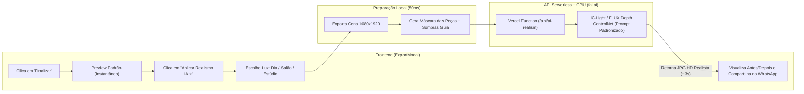

# Planejamento Técnico e Arquitetura: Modo IA (Realismo Padronizado) e Removedor de Fundo

> **Projeto:** Minha Festa (`app.minha-festa`)  
> **Data:** Outubro de 2026  
> **Objetivo:** Definir a arquitetura técnica, escolha de ferramentas, custos operacionais e fluxo de implementação para duas funcionalidades estratégicas:  
> 1. **Removedor de Fundo para Acervo do Cliente** (ao cadastrar peças próprias).  
> 2. **Modo IA de Realismo Pós-Decoração** (harmonização fotográfica, iluminação e sombras realistas sobre a montagem finalizada).  
> **Premissa Central:** Zero peso de processamento no celular/computador do cliente, alta confiabilidade visual e custo financeiro mínimo por operação.

---

## 1. Visão Geral do Problema e Premissas de Engenharia

Para que essas duas funções tenham sucesso comercial no **Minha Festa**, precisamos evitar duas armadilhas comuns:

1. **A armadilha do processamento local pesado (Client-Side AI):**  
   Rodar modelos de IA diretamente no navegador do celular (via WebAssembly/WebGPU, como `@imgly/background-removal`) exige que o cliente baixe entre **40 MB e 85 MB** de modelos e execute cálculos matriciais pesados na CPU/GPU do aparelho. Em celulares intermediários (Androids comuns ou iPhones com pouca RAM livre), isso trava a tela por 10 a 20 segundos, aquece o aparelho e frequentemente fecha a aba do navegador por falta de memória (*Out of Memory*). **Veredito:** O dispositivo do cliente deve fazer apenas o redimensionamento leve da imagem (que já fazemos em 50ms com [`optimizeUserUploadedImage`](file:///c:/Users/Usuario/dev/app.minha-festa/src/core/image-optimizer.ts#L7-L54)) e delegar a IA para uma API em nuvem ultrarrápida.

2. **A armadilha da "alucinação" no Modo Realismo:**  
   Uma decoradora usa o aplicativo para vender um orçamento real com as peças que ela **realmente possui no estoque**. Se o "Modo IA" alterar o formato da mesa, inventar flores que não existem ou mudar a estampa do painel, o cliente final cobrará na festa algo que a decoradora não tem. Portanto, o Modo IA **não pode ser um gerador livre**; ele precisa atuar como um **Motor de Pós-Produção Fotográfica Controlada** (Re-iluminação, Sombras de Contato, Reflexos e Integração Óptica), mantendo a fidelidade geométrica das peças do palco.

---

## 2. Funcionalidade 1: Removedor de Fundo da Imagem do Cliente

Quando a decoradora abre o modal de cadastro de peças ([`InventoryModal`](file:///c:/Users/Usuario/dev/app.minha-festa/src/ui/inventory-modal.ts#L5-L192)) e envia uma foto tirada na garagem ou no depósito, o sistema deve recortar apenas o objeto (vaso, mesa, display, personagem, bolo) com fundo 100% transparente.

### 2.1. Comparativo de Opções Técnicas

| Opção | Tecnologia / Provedor | Peso no Celular | Qualidade em Vazados (Ripas/Pés) | Tempo Médio | Custo por 1.000 Fotos |
| :--- | :--- | :---: | :---: | :---: | :---: |
| **A. IA no Navegador (Local)** | `@imgly/background-removal` (WASM) | **Alto (Risco de travar)** | Média | 8s a 25s | R$ 0,00 |
| **B. APIs SaaS Tradicionais** | Remove.bg / Photoroom API | Zero | Excelente | 1,5s | R$ 500,00 a R$ 1.100,00 |
| **C. Serverless GPU (Recomendada)** | **BiRefNet / BRIA RMBG-2.0 via fal.ai ou Replicate** | **Zero** | **Excelente (Estado da Arte)** | **0,8s a 1,5s** | **R$ 5,50 a R$ 12,00** |
| **D. Híbrida (Local Leve + Cloud)** | Flood-Fill em fundo branco + BiRefNet na nuvem | Mínimo | Excelente | 0,1s a 1,2s | **R$ 3,00 a R$ 8,00** |

### 2.2. A Escolha Recomendada: Opção C/D (BRIA RMBG-2.0 ou BiRefNet via Serverless GPU)

Hoje, os modelos **BRIA RMBG-2.0** e **BiRefNet (Bilateral Reference Network)** superaram o antigo `rembg` (U2Net). Eles conseguem recortar automaticamente:
- Vãos internos entre os pés de mesas bistrô, mesas cone ripadas e escadas;
- Contornos finos de arranjos florais e folhas;
- Displays de chão sem deixar aquela "borda branca" ao redor.

Em vez de pagar R$ 0,50 por foto no Remove.bg, você consome o modelo diretamente em provedores de **GPU Serverless por segundo** (como **fal.ai** ou **Replicate**), onde cada recorte custa entre **US$ 0.001 e US$ 0.002** (cerca de **R$ 0,006 a R$ 0,01 por foto** — ou seja, **1 centavo por peça cadastrada**).

### 2.3. Fluxo de Funcionamento Passo a Passo

```mermaid
sequenceDiagram
    autonumber
    actor User as Decoradora
    participant UI as InventoryModal (Frontend)
    participant Opt as image-optimizer.ts (Local)
    participant API as Backend Proxy (Vercel / Cloudflare)
    participant GPU as fal.ai / Replicate (RMBG-2.0 / BiRefNet)

    User->>UI: Seleciona foto da peça na galeria/câmera
    UI->>Opt: Redimensiona para máx 1024px (~120KB) em 50ms
    Opt-->>UI: Retorna imagem leve otimizada
    User->>UI: Clica em "Remover Fundo com IA ✨"
    UI->>API: POST /api/remove-bg (envia imagem 120KB)
    API->>GPU: Executa inferência BRIA RMBG-2.0
    GPU-->>API: Retorna PNG com transparência (Alpha Mask) em ~1s
    API-->>UI: Devolve PNG recortado + Auto-Trim (corte de margens vazias)
    UI->>User: Exibe preview transparente pronto para salvar no acervo
```

### 2.4. Detalhe Crucial: O "Auto-Trim" (Recorte de Margens Vazias)
No [`CanvasEngine`](file:///c:/Users/Usuario/dev/app.minha-festa/src/core/canvas-engine.ts), as medidas em centímetros (`widthCm` x `heightCm`) são aplicadas à caixa delimitadora da imagem. Se a IA remover o fundo mas sobrar espaço transparente vazio ao redor do vaso, a peça ficará menor do que deveria no palco.
- **Solução:** Assim que o PNG transparente voltar da API de IA, uma função leve no próprio navegador (5 linhas de Canvas 2D, execução em 10ms) detecta o primeiro e o último pixel não-transparente (`alpha > 15`) e **corta as bordas vazias automaticamente** (exatamente como fizemos nas mesas pedestal e na escada).

---

## 3. Funcionalidade 2: "Modo IA" para Realismo Padronizado na Decoração Finalizada

Quando a decoradora termina de montar o cenário no palco e clica em **Finalizar / Exportar** ([`ExportModal`](file:///c:/Users/Usuario/dev/app.minha-festa/src/ui/export-modal.ts#L4-L144)), hoje ela vê a montagem 2D exata. A ideia do **"Modo IA (Realismo Fotográfico)"** é ter um botão onde a montagem ganha vida: luz ambiente unificada, sombras reais projetadas no piso e na parede, volume tridimensional nos balões e integração de cores de câmera profissional.

### 3.1. Por que a maioria das IAs falha nisso e como resolver de forma confiável?

Se você apenas enviar a imagem exportada para uma IA com o prompt *"Torne esta festa realista"*, dois problemas acontecem:
1. **Se a força da IA (*denoising strength*) for alta (> 0.50):** A IA redesenha tudo. Ela troca os móveis da decoradora, deforma os personagens dos displays e altera o desenho da capa do painel.
2. **Se a força da IA for muito baixa (< 0.20):** Quase nada muda na iluminação e os itens continuam parecendo "colados" no cenário.

### 3.2. As 3 Opções para Implementar o "Modo IA" com Padronização e Fidelidade

#### Opção 1: Re-iluminação Neural Guiada por Máscara (**IC-Light V2 / Relighting**) — *Mais Confiável*
O modelo **IC-Light (Imposing Consistent Light)** foi criado especificamente para fotografia de produtos e cenários: ele recebe a imagem dos objetos e aplica **iluminação física consistente, sombras projetadas reais e reflexos**, **sem alterar a identidade, textura ou geometria dos objetos**.
- **Por que o nosso app tem uma vantagem única aqui?**  
  No [`CanvasEngine`](file:///c:/Users/Usuario/dev/app.minha-festa/src/core/canvas-engine.ts), nós temos o **fundo do salão separado das peças da decoração**! Nós podemos exportar, em 50 milissegundos:
  1. A imagem completa da montagem;
  2. A máscara exata (` foreground mask`) de todas as peças em relação ao fundo.
- Com isso, o modelo sabe exatamente o que é parede/chão e o que é mobília/balão, projetando sombras reais de cada cilindro, mesa e arco sobre o piso e unificando a luz sem distorcer nenhuma peça!

#### Opção 2: FLUX.1 ControlNet (Depth + Canny) com Denoising Controlado + Prompt Mestre Fixo
Utiliza o modelo **FLUX.1-dev com ControlNet Depth (Profundidade)** via API.
- O mapa de profundidade trava 100% da posição, formato e proporção de cada cilindro, mesa, painel e balão.
- Usamos um `strength` (força de transformação) travado em **0.28 a 0.35** e uma `seed` (semente) padronizada.
- A decoradora **não digita prompts livres** (evitando resultados imprevisíveis). Ela apenas escolhe entre **3 Presets de Iluminação Padronizados**:
  1. **☀️ Luz Natural (Jardim / Dia):** Luz solar suave lateral, sombras difusas claras, cores vibrantes.
  2. **✨ Salão Festa (Quente / Lustres):** Iluminação aconchegante 3200K vinda do topo, brilho suave nos balões e piso com leve reflexo.
  3. **📸 Estúdio Clean (Catálogo):** Iluminação frontal difusa de softbox, sombras suaves simétricas e nitidez comercial.

#### Opção 3: Pipeline Híbrido — Pós-Processamento Geométrico no Canvas (Custo Zero) + Passe de IA
Antes mesmo de chamar a IA (ou como um modo instantâneo gratuito), o próprio `CanvasEngine` pode aplicar um **Renderizador de Sombras de Contato e Ambient Occlusion** na hora de exportar:
- Como sabemos a coordenada `Y` da base de cada mesa, cilindro e display no chão, podemos desenhar sombras de contato elípticas suaves + sombra projetada angular + *Color Grading* (ajuste óptico de contraste e temperatura).
- Em seguida, se a usuária clicar em **"Realismo IA Pro"**, enviamos essa imagem já com as sombras de referência para a API de IA fazer apenas o refinamento fotográfico final. **Resultado:** A IA nunca erra onde está o chão porque as sombras-guia já estão desenhadas!

### 3.3. Comparativo das Opções para o "Modo IA"

| Critério | Opção 1: IC-Light (Relighting Neural) | Opção 2: FLUX ControlNet Depth (Baixo Denoise) | Opção 3: Canvas Pós-Proc + IA Híbrida |
| :--- | :---: | :---: | :---: |
| **Fidelidade às Peças da Decoradora** | **99% (Não altera as peças)** | 92% (Suaviza bordas e dá volume 3D) | **98% (Melhor equilíbrio)** |
| **Qualidade de Luz e Sombras** | Excelente | Excelente (Textura de foto real) | Excelente e 100% previsível |
| **Padronização (Mesmo padrão sempre)** | Altíssima | Alta | **Altíssima** |
| **Tempo de Resposta** | ~2 a 4 segundos | ~3 a 5 segundos | 0,1s (Base) + 2,5s (IA) |
| **Custo por Imagem Gerada** | ~R$ 0,02 a R$ 0,04 | ~R$ 0,05 a R$ 0,09 | **~R$ 0,02 a R$ 0,05** |

> [!TIP]
> **Recomendação para o Modo IA:** Adotar a **Opção 3 combinada com IC-Light / FLUX ControlNet via fal.ai**. No Modal de Exportação, oferecemos uma chave seletora (*"Visual Original 2D"* vs. *"Modo Realismo IA ✨"*), com um comparador "Antes / Depois" e a certeza de que a imagem original continua salva caso ela queira alternar.

### 3.4. Fluxo de Funcionamento do "Modo IA" na Exportação



---

## 4. Arquitetura de Infraestrutura: Como Implementar e Manter Rodando

Para que você **não tenha dor de cabeça mantendo servidores ligados 24h**, a arquitetura inteira deve ser **100% Serverless (Sem Servidor Dedicado)**. Você só paga centavos quando um usuário aperta o botão, e se ninguém usar na madrugada, o custo é **R$ 0,00**.

### 4.1. As Ferramentas Necessárias

1. **Hospedagem do App e das Rotas de API:** **Vercel** (ou **Cloudflare Pages/Workers**).
   - O seu projeto Vite já é estático. Basta criar uma pasta `/api` na raiz do projeto com dois arquivos:
     - `api/remove-bg.ts`
     - `api/enhance-realism.ts`
   - A própria Vercel transforma esses dois arquivos em *Serverless Functions* seguras que guardam sua chave de API secreta (`FAL_KEY`).
2. **Provedor de GPU para os Modelos de IA:** **fal.ai** (ou **Replicate**).
   - Por que o **fal.ai** é hoje o favorito para aplicativos interativos?
     - É o provedor mais rápido do mercado (*cold start* quase zero para `birefnet`, `bria/rmbg-2.0`, `ic-light` e `flux-controlnet`).
     - Possui SDK oficial minúsculo para TypeScript (`@fal-ai/client`).
     - Sistema de créditos pré-pagos (você coloca, por exemplo, US$ 10 de saldo e trava um limite máximo para nunca ter surpresas no cartão).

### 4.2. Exemplo Prático de Como Ficaria o Código

#### 1. No Backend (`api/remove-bg.ts` — Roda na Vercel):
```typescript
// Exemplo conceitual da rota Serverless (protege a chave de API)
import { fal } from '@fal-ai/client';

export default async function handler(req: any, res: any) {
  if (req.method !== 'POST') return res.status(405).end();

  const { imageBase64 } = req.body;

  // Chama o modelo BRIA RMBG 2.0 ou BiRefNet na GPU da fal.ai
  const result = await fal.subscribe('fal-ai/birefnet/v2', {
    input: {
      image_url: imageBase64,
      model: 'General Use (Light)', // Rápido e preciso para objetos e móveis
      operating_resolution: '1024x1024',
      output_format: 'png'
    }
  });

  return res.status(200).json({ imageUrl: result.data.image.url });
}
```

#### 2. No Backend (`api/enhance-realism.ts` — Modo IA Padronizado):
```typescript
// Prompt padronizado e travado no backend para garantir consistência
const LIGHTING_PRESETS: Record<string, string> = {
  studio: 'Professional studio photography of a party decoration setup, soft diffused key lighting, natural contact shadows on the floor, realistic balloon reflections, 8k photorealistic, preserve exact object shapes and colors.',
  warm_hall: 'Luxury indoor party venue photography, warm ambient chandelier lighting 3200K, realistic floor shadows and subtle floor reflection, photorealistic, preserve exact furniture and backdrop.',
  daylight: 'Natural daylight indoor event photography, soft window light from side, realistic ambient occlusion and contact shadows on floor, high detail.'
};

export default async function handler(req: any, res: any) {
  const { sceneImageBase64, preset = 'studio' } = req.body;

  const result = await fal.subscribe('fal-ai/ic-light-v2', {
    input: {
      image_url: sceneImageBase64,
      prompt: LIGHTING_PRESETS[preset] || LIGHTING_PRESETS.studio,
      // Mantém a estrutura e cores originais aplicando iluminação e sombras reais
      cfg: 2.0,
      steps: 20
    }
  });

  return res.status(200).json({ realisticImageUrl: result.data.images[0].url });
}
```

---

## 5. Análise Financeira: Custos Reais e Como Evitar Desperdícios

Considerando cotação aproximada de **US$ 1.00 = R$ 5,80**:

### 5.1. Custo Unitário por Operação
- **Remover fundo de 1 foto do cliente (`BiRefNet` / `RMBG-2.0`):** ~US$ 0.0015 (**~R$ 0,009** — menos de 1 centavo).
- **Gerar 1 imagem no "Modo IA Realismo" (`IC-Light` / `ControlNet`):** ~US$ 0.005 a US$ 0.01 (**~R$ 0,03 a R$ 0,06** por decoração finalizada).

### 5.2. Simulação de Custo Mensal por Escala de Uso

| Cenário de Uso | Remoções de Fundo / mês | Decorações no Modo IA / mês | Custo Mensal de Hospedagem (Vercel) | Custo Mensal de IA (fal.ai) | **Custo Total Mensal** |
| :--- | :---: | :---: | :---: | :---: | :---: |
| **Fase Inicial (Testes / MVP)** | 300 fotos | 200 cenários | R$ 0,00 (Plano Hobby) | ~R$ 12,00 | **~R$ 12,00 / mês** |
| **Fase Comercial (50 assinantes)** | 2.000 fotos | 1.500 cenários | R$ 0,00 | ~R$ 85,00 | **~R$ 85,00 / mês** |
| **Fase Escala (300 assinantes)** | 10.000 fotos | 8.000 cenários | R$ 115,00 (Vercel Pro) | ~R$ 450,00 | **~R$ 565,00 / mês** |

*(Nota: Na Fase Escala com 300 assinantes pagando, por exemplo, R$ 49,90/mês, a receita seria de R$ 14.970,00/mês e o custo de IA representaria menos de **3% do faturamento**).*

---

## 6. Mecanismos de Economia e Proteção de Caixa (Anti-Desperdício)

Para garantir que nenhum usuário gere custos excessivos acidentalmente ou por abuso:

1. **Remoção de Fundo 1 Única Vez no Cadastro (Cache Permanente):**
   - O cliente remove o fundo **quando cadastra a peça no Meu Acervo**, e o PNG transparente já fica salvo no banco de dados (`IndexedDB` / nuvem).
   - Nas próximas 500 festas em que ele usar aquela mesma peça, o custo de IA será **zero**, pois a peça já está recortada!

2. **Cache de Hash no Modo IA (Evita Cliques Repetidos):**
   - Se o usuário clicar em "Gerar Modo IA", voltar para o canvas, **não mudar nada** e clicar em "Gerar Modo IA" de novo, o aplicativo verifica que o estado da cena não mudou e exibe a imagem realista já gerada anteriormente em cache, sem cobrar nova chamada na API.

3. **Redimensionamento Antes do Envio:**
   - Fotos de câmera de celular têm 4000x3000px (12 Megapixels). Enviar isso para a IA custa 4x mais caro e demora 3x mais na rede 4G.
   - Redimensionar localmente para **1024px** (peças individuais) e **1080x1920px** (cenário completo) antes do upload mantém a qualidade máxima para tela/WhatsApp e reduz o custo e o tempo pela metade.

4. **Trava de Limite Diário por Usuário (Rate Limiting):**
   - Limitar, por exemplo, a **15 gerações de Modo IA por dia por usuário** e **30 remoções de fundo por dia**. Para uma decoradora real isso é mais do que suficiente para trabalhar o dia inteiro, mas impede que alguém use um robô para gastar seus créditos.

---

## 7. Roteiro Sugerido para Implementação (Quando você autorizar)

Quando decidirmos iniciar a codificação, podemos dividir em **3 etapas rápidas e seguras**:

- **Etapa 1 — Infraestrutura e Removedor de Fundo no Meu Acervo:**
  1. Criar a função serverless `/api/remove-bg` conectada ao `BiRefNet` / `RMBG-2.0`.
  2. Adicionar o botão **"✨ Remover Fundo Automaticamente"** dentro do [`InventoryModal`](file:///c:/Users/Usuario/dev/app.minha-festa/src/ui/inventory-modal.ts) logo após o usuário escolher a foto, com *Auto-Trim* automático das bordas transparentes.
- **Etapa 2 — Sombras de Contato e Harmonização Óptica Nativa:**
  1. Adicionar gerador de sombras de contato no piso para todas as peças na hora da exportação.
- **Etapa 3 — Botão "Modo Realismo IA" no Modal de Exportação:**
  1. Criar a função serverless `/api/enhance-realism`.
  2. Na tela de [`ExportModal`](file:///c:/Users/Usuario/dev/app.minha-festa/src/ui/export-modal.ts), adicionar a opção **"✨ Aplicar Realismo com IA"** com seletor de iluminação (*Luz Natural*, *Salão Quente*, *Estúdio*) e botão de alternar entre a versão 2D original e a versão realista antes de baixar ou compartilhar no WhatsApp.

